<div align="center">



<br />

<a href="https://pranavmahindru.com/"></a>
<a href="https://www.linkedin.com/in/pmahindru/"></a>
<a href="https://pranavmahindru.medium.com/"></a>
<a href="https://calendly.com/pranavmahindru-work/30min"></a>


<br />


</div>


### `01 / THE PERSON BEHIND THE CODE`

```typescript
interface Developer {
  name: string;
  location: string;
  specialty: string[];
  learning: string[];
  principle: string;
}

const pranav: Developer = {
  name: "Pranav Mahindru",
  location: "Halifax, Nova Scotia, Canada",
  specialty: ["Full-stack apps", "REST APIs", "Cloud infrastructure"],
  learning: ["AI agents", "RAG", "System design", "Automation"],
  principle: "Make it useful. Make it elegant. Make it reliable.",
};
```

I’m a software developer working across **React, Next.js, TypeScript, Node.js, AWS, and Docker**. I like products where engineering quality and visual polish reinforce each other—fast APIs, dependable systems, and interfaces people enjoy using.

Previously, I worked on full-stack features, developer tools, and cloud infrastructure at **KOII Network**, and enterprise APIs and testing at **Introhive**. I also enjoy learning about AI-assisted software, developer experience, and system architecture.


### `02 / THE ENGINEERING ATELIER`

<div align="center">

**I. FRONTEND · INTERFACE CRAFT**


**II. BACKEND · DATA SYSTEMS**


**III. CLOUD · DELIVERY · TOOLING**


</div>


### `03 / AREAS OF CRAFT`

| Discipline | What I build and optimize |
|:--|:--|
| **01 · Product Interfaces** | Responsive applications, accessible workflows, thoughtful UI performance |
| **02 · API Engineering** | RESTful services, integrations, backend performance and reliability |
| **03 · Cloud & Delivery** | AWS-based solutions, Dockerized deployments, operational improvements |
| **04 · Developer Experience** | Tooling, extensions, debugging workflows and maintainable systems |
| **05 · Next Frontier** | Learning AI agents, retrieval-augmented generation and automation |


### `04 / LIVE ENGINEERING SIGNALS`

<div align="center">

<picture>
  <source media="(prefers-color-scheme: dark)" srcset="https://github-readme-stats.vercel.app/api?username=pmahindru&amp;show_icons=true&amp;hide_border=true&amp;bg_color=0C0C13&amp;title_color=E8C88A&amp;text_color=DFDCE7&amp;icon_color=A88AF7&amp;rank_icon=github" />
  
</picture>
<picture>
  <source media="(prefers-color-scheme: dark)" srcset="https://streak-stats.demolab.com?user=pmahindru&amp;hide_border=true&amp;background=0C0C13&amp;ring=E5BE78&amp;fire=A88AF7&amp;currStreakLabel=E5BE78&amp;sideLabels=DFDCE7&amp;dates=A9A1B3" />
  
</picture>

<br />


<br />


<sub>Dynamic metrics are generated by third-party services and may occasionally fail to load or omit private activity.</sub>

</div>


### `05 / THE GOLDEN SNAKE · CONTRIBUTION TRAIL`

<div align="center">

<!-- The snake appears after the GitHub Action is run once successfully. -->
<picture>
  <source media="(prefers-color-scheme: dark)" srcset="https://raw.githubusercontent.com/pmahindru/pmahindru/output/github-snake-dark.svg" />
  
</picture>

<sub>Generated automatically using GitHub Actions. Animation is paused when reduced motion is enabled by your browser.</sub>

</div>


### `06 / THE NEXT CHAPTER`

<div align="center">

**Building useful software. Learning in public. Exploring what comes next.**

[**Explore my work**](https://pranavmahindru.com/) &nbsp; ✦ &nbsp;
[**Connect on LinkedIn**](https://www.linkedin.com/in/pmahindru/) &nbsp; ✦ &nbsp;
[**Read my writing**](https://pranavmahindru.medium.com/) &nbsp; ✦ &nbsp;
[**Book a conversation**](https://calendly.com/pranavmahindru-work/30min)

<br />


<sub>PRANAV MAHINDRU · ENGINEERED WITH INTENT</sub>

</div>
